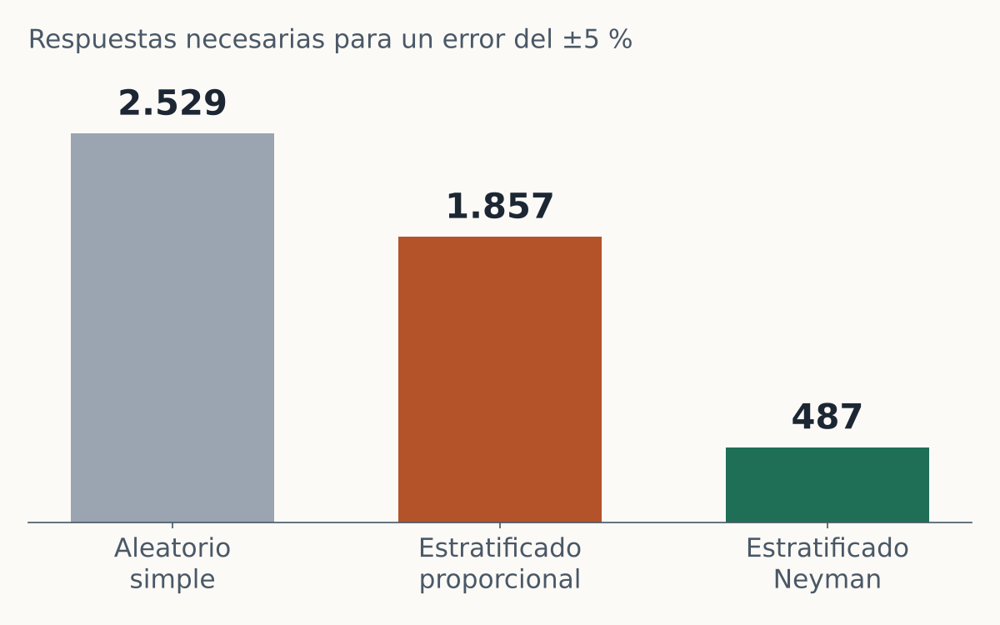
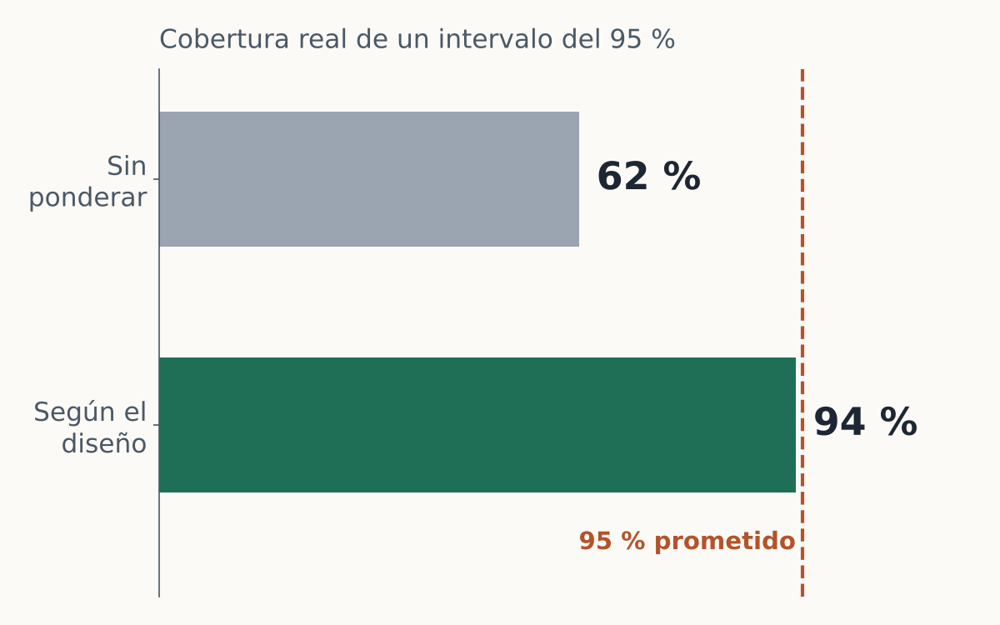
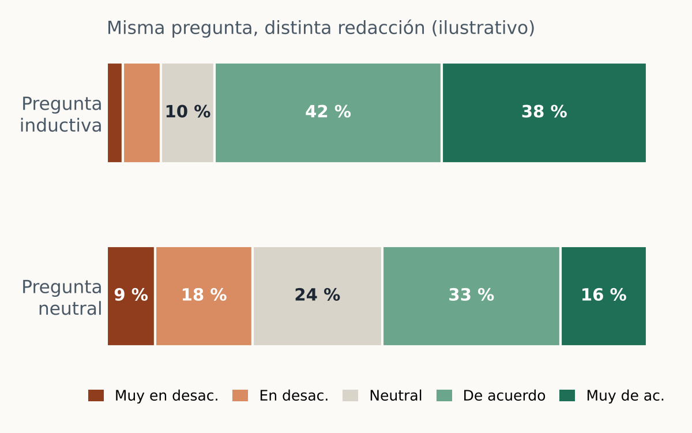

```{=html}
<style>#title-block-header{display:none;}</style>

<!-- ============ PORTADA ============ -->
<section class="banda hero2">
 <div class="contenedor hero2-grid">
  <div class="hero2-texto">
   <div class="kicker">Doctor en Economía · Científico de datos · Estadístico</div>
   <h1>Datos bien medidos,<br><span class="resalte">decisiones bien fundadas.</span></h1>
   <p class="lead">Acompaño a empresas, cámaras, cooperativas, consultoras y organizaciones privadas en todo el ciclo de la información: desde el diseño de la muestra y del cuestionario hasta el análisis, el modelo predictivo y la formación de sus equipos.</p>
   <div class="cta">
    <a class="btn-principal" href="contacto.html">Conversemos sobre su proyecto</a>
    <a class="btn-secundario" href="portfolio/index.html">Ver casos de trabajo</a>
   </div>
  </div>

  <div class="hero2-visual" aria-hidden="true">
   <svg class="orbita" viewBox="0 0 400 400"><circle cx="200" cy="200" r="190" fill="none" stroke="#1f6f57" stroke-opacity=".25" stroke-dasharray="3 7"/></svg>
   

   <div class="chip chip-a">
    <span class="chip-t">Intervalo de confianza</span>
    <svg viewBox="0 0 140 52"><path d="M4 48 C 34 48, 46 6, 70 6 S 106 48, 136 48" fill="none" stroke="#1c2733" stroke-width="2"/>
     <path d="M44 48 C 52 30, 58 8, 70 6 S 88 30, 96 48 Z" fill="#1f6f57" fill-opacity=".85"/>
     <line x1="70" y1="6" x2="70" y2="48" stroke="#fbfaf7" stroke-width="1.5" stroke-dasharray="2 2"/></svg>
    <span class="chip-v">95 %</span>
   </div>

   <div class="chip chip-b">
    <span class="chip-t">Muestra óptima</span>
    <svg viewBox="0 0 140 52"><rect x="8" y="10" width="26" height="40" rx="3" fill="#9aa5b1"/><rect x="48" y="20" width="26" height="30" rx="3" fill="#b4532a"/><rect x="88" y="38" width="26" height="12" rx="3" fill="#1f6f57"/></svg>
    <span class="chip-v">−81 % encuestas</span>
   </div>

   <div class="chip chip-c">
    <span class="chip-t">Tendencia</span>
    <svg viewBox="0 0 140 52">
     <g fill="#1f6f57"><circle cx="12" cy="42" r="3"/><circle cx="26" cy="38" r="3"/><circle cx="38" cy="40" r="3"/><circle cx="52" cy="30" r="3"/><circle cx="66" cy="32" r="3"/><circle cx="80" cy="22" r="3"/><circle cx="94" cy="24" r="3"/><circle cx="108" cy="14" r="3"/><circle cx="124" cy="12" r="3"/></g>
     <line x1="8" y1="45" x2="132" y2="8" stroke="#b4532a" stroke-width="2.5" stroke-linecap="round"/></svg>
   </div>
  </div>
 </div>
</section>

<!-- ============ SERVICIOS ============ -->
<section class="banda">
 <div class="contenedor">
  <div class="encabezado-seccion">
   <span class="kicker">Servicios</span>
   <h2>Todo el ciclo del dato, de la pregunta a la decisión</h2>
  </div>

  <div class="tarjetas-ico">
   <a class="tarjeta-ico" href="servicios.html#muestras">
    <svg class="icono" viewBox="0 0 48 48"><g fill="none" stroke="#9aa5b1" stroke-width="1.6"><circle cx="9" cy="9" r="3"/><circle cx="19" cy="9" r="3"/><circle cx="39" cy="9" r="3"/><circle cx="9" cy="19" r="3"/><circle cx="29" cy="19" r="3"/><circle cx="39" cy="19" r="3"/><circle cx="19" cy="29" r="3"/><circle cx="29" cy="29" r="3"/><circle cx="9" cy="39" r="3"/><circle cx="29" cy="39" r="3"/><circle cx="39" cy="39" r="3"/></g><g fill="#1f6f57"><circle cx="29" cy="9" r="3.6"/><circle cx="19" cy="19" r="3.6"/><circle cx="39" cy="29" r="3.6"/><circle cx="9" cy="29" r="3.6"/><circle cx="19" cy="39" r="3.6"/></g></svg>
    <h3>Diseño de muestras</h3>
    <p>Encuestas de mercado, satisfacción, clima laboral u opinión con un diseño probabilístico defendible y márgenes de error conocidos de antemano.</p>
   </a>
   <a class="tarjeta-ico" href="servicios.html#cuestionarios">
    <svg class="icono" viewBox="0 0 48 48"><rect x="9" y="6" width="30" height="38" rx="3" fill="none" stroke="#1c2733" stroke-width="1.8"/><rect x="18" y="3" width="12" height="6" rx="2" fill="#b4532a"/><g stroke="#1f6f57" stroke-width="2" fill="none" stroke-linecap="round"><path d="M14 17l2.5 2.5L21 15"/><path d="M14 27l2.5 2.5L21 25"/></g><rect x="14" y="34" width="6" height="6" rx="1" fill="none" stroke="#9aa5b1" stroke-width="1.6"/><g stroke="#9aa5b1" stroke-width="2" stroke-linecap="round"><line x1="25" y1="18" x2="34" y2="18"/><line x1="25" y1="28" x2="34" y2="28"/><line x1="25" y1="37" x2="34" y2="37"/></g></svg>
    <h3>Cuestionarios y formularios</h3>
    <p>Redacción de preguntas, escalas, flujos de salto, validaciones y prueba piloto, en papel o en plataformas digitales.</p>
   </a>
   <a class="tarjeta-ico" href="servicios.html#encuestas">
    <svg class="icono" viewBox="0 0 48 48"><line x1="5" y1="43" x2="44" y2="43" stroke="#1c2733" stroke-width="1.8"/><rect x="9" y="22" width="8" height="21" rx="1.5" fill="#9aa5b1"/><rect x="21" y="14" width="8" height="29" rx="1.5" fill="#1f6f57"/><rect x="33" y="26" width="8" height="17" rx="1.5" fill="#b4532a"/><g stroke="#1c2733" stroke-width="1.6"><path d="M13 17v10M11 17h4M11 27h4"/><path d="M25 8v12M23 8h4M23 20h4"/><path d="M37 21v10M35 21h4M35 31h4"/></g></svg>
    <h3>Análisis de encuestas</h3>
    <p>Ponderación, estimaciones con errores estándar correctos, tablas con significación, índices y modelos sobre datos de encuesta.</p>
   </a>
   <a class="tarjeta-ico" href="servicios.html#ciencia-de-datos">
    <svg class="icono" viewBox="0 0 48 48"><g fill="#1f6f57"><circle cx="10" cy="12" r="3"/><circle cx="16" cy="8" r="3"/><circle cx="14" cy="18" r="3"/><circle cx="21" cy="14" r="3"/><circle cx="8" cy="22" r="3"/></g><g fill="#b4532a"><circle cx="32" cy="34" r="3"/><circle cx="38" cy="30" r="3"/><circle cx="36" cy="40" r="3"/><circle cx="42" cy="37" r="3"/><circle cx="28" cy="40" r="3"/></g><g fill="#9aa5b1"><circle cx="34" cy="12" r="3"/><circle cx="40" cy="16" r="3"/><circle cx="36" cy="20" r="3"/></g><path d="M4 34 C 18 30, 26 22, 44 4" fill="none" stroke="#1c2733" stroke-width="1.6" stroke-dasharray="3 3"/></svg>
    <h3>Ciencia de datos</h3>
    <p>Modelos predictivos, segmentación de clientes, pronósticos de demanda, tableros y reportes automatizados en R y Python.</p>
   </a>
   <a class="tarjeta-ico" href="servicios.html#analisis-economico">
    <svg class="icono" viewBox="0 0 48 48"><path d="M6 4v38h38" fill="none" stroke="#1c2733" stroke-width="1.8"/><polyline points="10,34 18,28 25,31 33,19 41,11" fill="none" stroke="#1f6f57" stroke-width="2.6" stroke-linejoin="round" stroke-linecap="round"/><path d="M35 10l6 1-1 6" fill="none" stroke="#1f6f57" stroke-width="2.6" stroke-linecap="round" stroke-linejoin="round"/><polyline points="10,38 18,36 25,37 33,33 41,31" fill="none" stroke="#b4532a" stroke-width="1.8" stroke-dasharray="3 3"/></svg>
    <h3>Análisis económico</h3>
    <p>Estudios de mercado y sectoriales, evaluación de proyectos, costos, precios y competitividad con herramientas econométricas.</p>
   </a>
   <a class="tarjeta-ico" href="capacitaciones.html">
    <svg class="icono" viewBox="0 0 48 48"><rect x="5" y="5" width="38" height="26" rx="2" fill="none" stroke="#1c2733" stroke-width="1.8"/><path d="M24 31v8M16 44l8-5 8 5" fill="none" stroke="#1c2733" stroke-width="1.8" stroke-linecap="round"/><path d="M10 25 C 16 25, 18 11, 24 11 S 32 25, 38 25" fill="none" stroke="#1f6f57" stroke-width="2.2"/><circle cx="24" cy="11" r="2.4" fill="#b4532a"/></svg>
    <h3>Cursos y capacitaciones</h3>
    <p>Formación a medida en estadística, muestreo, R y Python, ciencia de datos e IA, con ejemplos construidos sobre problemas reales.</p>
   </a>
  </div>
 </div>
</section>

<!-- ============ CIFRAS ============ -->
<section class="banda banda-cifras">
 <div class="contenedor">
  <div class="cifras2">
   <div><span class="n" data-hasta="7">7</span><span class="t">títulos universitarios de grado y posgrado</span></div>
   <div><span class="n" data-hasta="18" data-sufijo="+">18+</span><span class="t">años de docencia universitaria</span></div>
   <div><span class="n" data-hasta="30" data-sufijo="+">30+</span><span class="t">artículos, capítulos y trabajos publicados</span></div>
   <div><span class="n" data-hasta="3">3</span><span class="t">posgrados en curso, entre ellos el Doctorado en Estadística</span></div>
  </div>
  <p class="credenciales">Doctor en Ciencias Económicas (UNC) · Magíster en Econometría (UTDT), en Métodos Cuantitativos (UBA), en Explotación de Datos (Austral) y en Políticas Públicas (FLACSO) · Doctorando en Estadística (UNR)</p>
  <a class="enlace-claro" href="sobre-mi.html">Conocer mi trayectoria →</a>
 </div>
</section>

<!-- ============ VITRINA DE CASOS ============ -->
<section class="banda">
 <div class="contenedor">
  <div class="encabezado-seccion">
   <span class="kicker">Portfolio</span>
   <h2>Así se ve el trabajo</h2>
   <p class="bajada">Casos reproducibles con datos simulados o públicos, con el código completo a la vista.</p>
  </div>
  <div class="vitrina">
   <a class="caso" href="portfolio/diseno-muestral.html">
    
    <div class="caso-cuerpo"><span class="etiqueta">Diseño muestral</span><h3>La misma precisión con 81 % menos encuestas</h3><p>Estratificación y asignación de Neyman para una encuesta a clientes de un mayorista.</p></div>
   </a>
   <a class="caso" href="portfolio/encuesta-ponderada.html">
    
    <div class="caso-cuerpo"><span class="etiqueta">Análisis de encuestas</span><h3>Cuando el promedio simple engaña</h3><p>Ponderación y errores estándar según el diseño en una encuesta de clima laboral.</p></div>
   </a>
   <a class="caso" href="portfolio/cuestionario.html">
    
    <div class="caso-cuerpo"><span class="etiqueta">Cuestionarios</span><h3>Siete errores al redactar un formulario</h3><p>Revisión de un cuestionario de satisfacción antes de salir a campo.</p></div>
   </a>
  </div>
 </div>
</section>

<!-- ============ PROCESO ============ -->
<section class="banda banda-suave">
 <div class="contenedor">
  <div class="encabezado-seccion">
   <span class="kicker">Cómo trabajo</span>
   <h2>Un proceso claro, sin sorpresas</h2>
  </div>
  <ol class="proceso">
   <li><span class="paso">1</span><h3>Diagnóstico sin costo</h3><p>Una primera conversación para entender la pregunta de negocio y decidir si los datos pueden responderla.</p></li>
   <li><span class="paso">2</span><h3>Propuesta escrita</h3><p>Alcance, método, plazos, entregables y honorarios definidos antes de comenzar.</p></li>
   <li><span class="paso">3</span><h3>Trabajo reproducible</h3><p>Cada análisis queda documentado en código, para auditarlo, repetirlo y actualizarlo.</p></li>
   <li><span class="paso">4</span><h3>Entrega comprensible</h3><p>Informes y tableros pensados para quien decide, con la técnica disponible para quien quiera revisarla.</p></li>
  </ol>
 </div>
</section>

<!-- ============ LLAMADO FINAL ============ -->
<section class="banda banda-cta">
 <div class="contenedor cta-final">
  <div>
   <h2>¿Tiene datos y una decisión pendiente?</h2>
   <p>Cuénteme el problema en pocas líneas. La primera conversación no tiene costo.</p>
  </div>
  <a class="btn-claro" href="contacto.html">Escribirme</a>
 </div>
</section>

<div class="contenedor">
 <p class="nota-independencia">Trabajo exclusivamente con datos propios del cliente o con fuentes públicas oficialmente difundidas, bajo acuerdo de confidencialidad. <a href="independencia.html">Leer la declaración de independencia y confidencialidad.</a></p>
</div>

<script>
(function () {
  var reducir = window.matchMedia && window.matchMedia('(prefers-reduced-motion: reduce)').matches;
  var nums = document.querySelectorAll('.cifras2 .n[data-hasta]');
  if (reducir || !('IntersectionObserver' in window)) return;
  var obs = new IntersectionObserver(function (entradas) {
    entradas.forEach(function (e) {
      if (!e.isIntersecting) return;
      var el = e.target, fin = +el.dataset.hasta, suf = el.dataset.sufijo || '', t0 = null;
      function paso(t) {
        if (!t0) t0 = t;
        var p = Math.min((t - t0) / 1100, 1), v = Math.round(fin * (1 - Math.pow(1 - p, 3)));
        el.textContent = v + (p === 1 ? suf : '');
        if (p < 1) requestAnimationFrame(paso);
      }
      requestAnimationFrame(paso);
      obs.unobserve(el);
    });
  }, { threshold: 0.6 });
  nums.forEach(function (n) { obs.observe(n); });
})();
</script>
```
